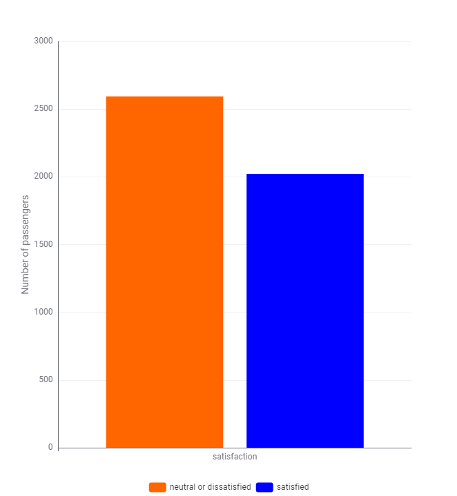
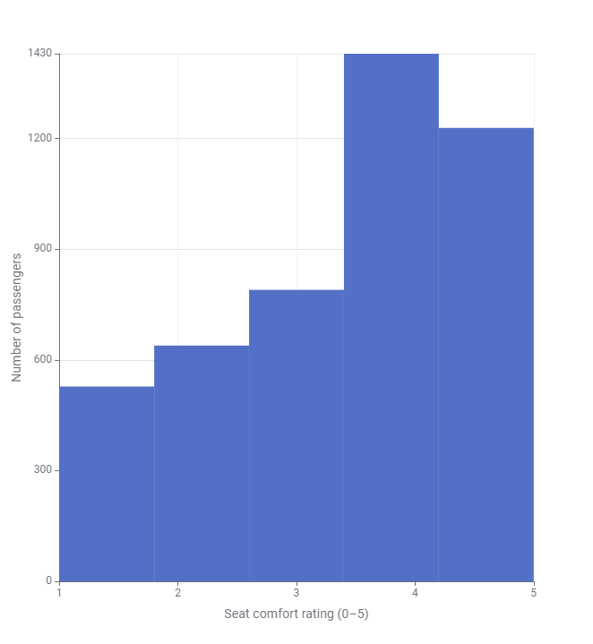
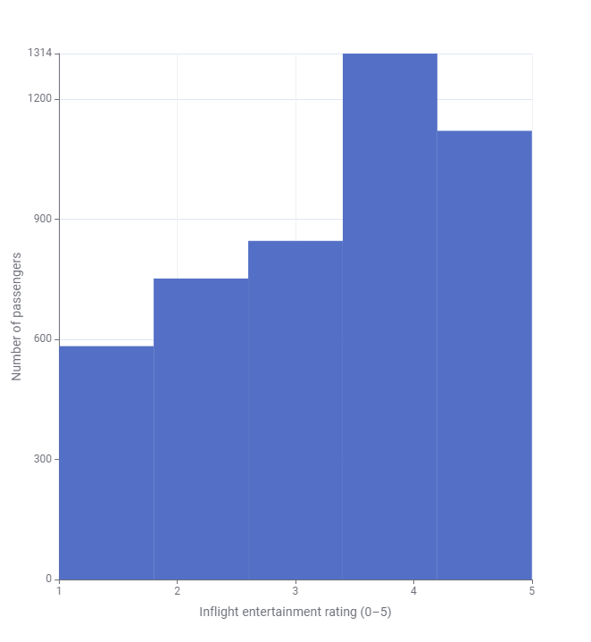
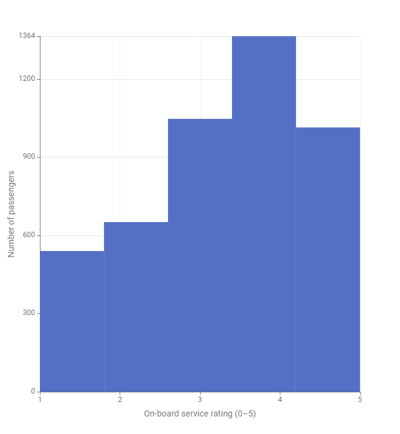
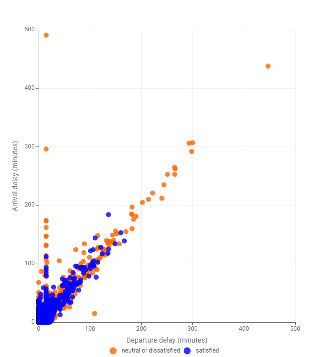
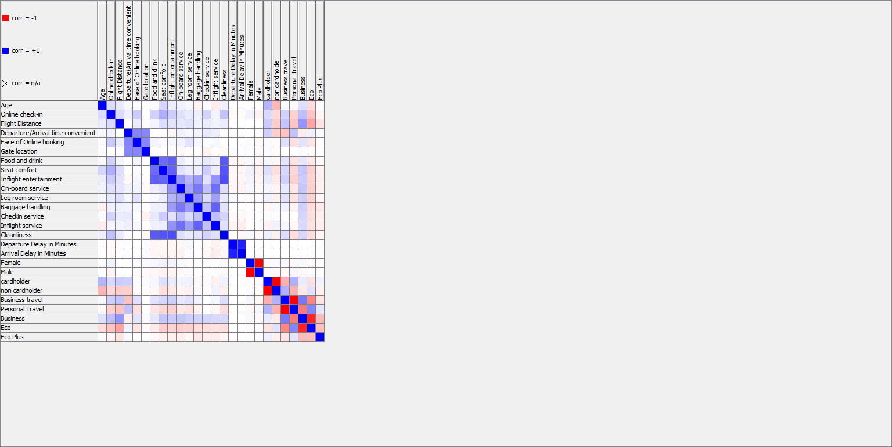
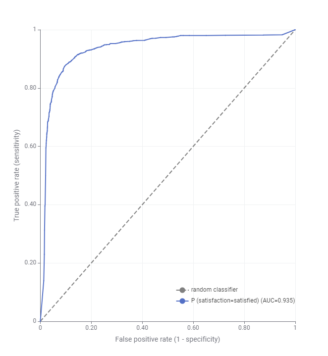
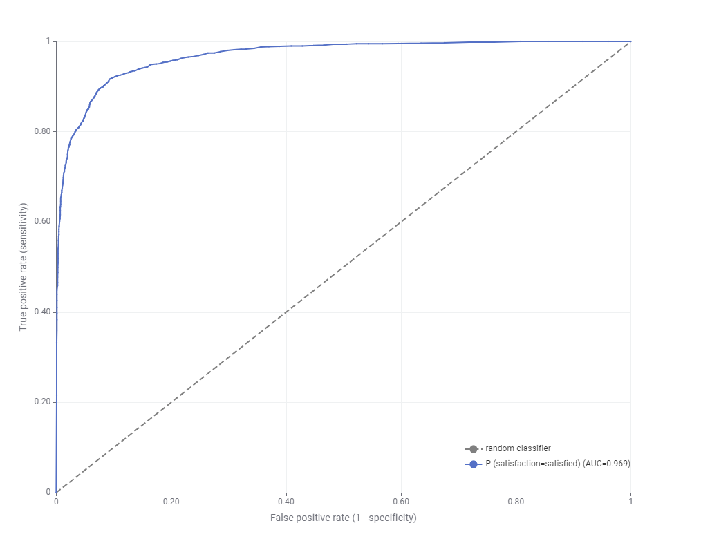
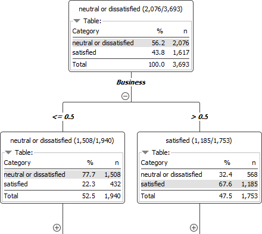

# Airline Passenger Satisfaction Prediction Using Machine Learning

## Project Overview

This project predicts airline passenger satisfaction using supervised machine learning techniques implemented in KNIME Analytics Platform.

The analysis investigates how passenger demographics, travel characteristics, service quality ratings and flight delays relate to overall satisfaction. Two classification algorithms, Decision Tree and Random Forest, were developed and evaluated to identify influential predictors and compare predictive performance.

The project covers data preprocessing, exploratory data analysis (EDA), feature encoding, predictive modelling, stratified cross-validation, model evaluation and interpretability.

The Random Forest achieved **90.2% accuracy and a ROC-AUC of 0.969**, outperforming the Decision Tree in overall predictive performance.

## Project Structure

```text
airline-passenger-satisfaction-prediction/
│
├── 01_data/
│   └── airline_satisfaction_data.csv
│
├── 02_workflow/
│   └── airline_satisfaction_prediction.knwf
│
├── 03_visualisations/
│   ├── arrival_delay_scatter_plot.png
│   ├── correlation_heatmap.png
│   ├── decision_tree.png
│   ├── decision_tree_roc_curve.png
│   ├── inflight_entertainment.png
│   ├── on_board_service.png
│   ├── random_forest_roc_curve.png
│   ├── satisfaction_distribution.png
│   └── seat_comfort.png
│
├── 04_reports/
│   └── airline_satisfaction_model_comparison.pdf
│
└── README.md
```

### Directory Overview

| Directory / File | Description |
|------------------|-------------|
| `01_data/` | Airline passenger satisfaction dataset used for analysis and modelling. |
| `02_workflow/` | KNIME workflow containing data preprocessing, visualisation, model training and evaluation. |
| `03_visualisations/` | Nine figures covering exploratory analysis, model interpretation and predictive performance. |
| `04_reports/` | Detailed report documenting the methodology, model evaluation and findings. |
| `README.md` | Project overview, methods, results and instructions. |

## Dataset

The project uses an airline passenger satisfaction dataset derived from a modified Kaggle dataset.

- **Dataset:** Airline Passenger Satisfaction
- **File:** `01_data/airline_satisfaction_data.csv`
- **Records in the supplied CSV:** 5,196
- **Columns:** 23, including the target variable
- **Target:** `satisfaction`

The dataset contains information about passenger demographics, travel details, airline services and flight delays.

### Key Features

| Category | Features |
|----------|----------|
| Passenger Demographics | Age, Gender, Customer Loyalty |
| Travel Information | Type of Travel, Class, Flight Distance |
| Service Ratings | Seat Comfort, Inflight Entertainment, Food and Drink, On-board Service, Cleanliness |
| Airport Services | Online Check-in, Gate Location, Baggage Handling, Check-in Service |
| Flight Delays | Departure Delay in Minutes, Arrival Delay in Minutes |
| Target Variable | Satisfaction |

### Target Variable

The classification task distinguishes between two passenger satisfaction categories:

- **Satisfied**
- **Neutral or Dissatisfied**

The supplied CSV contains 5,196 records before preprocessing. The original project report documents a dataset of 5,198 records and model evaluation results involving 4,616 observations. These differences should be reconciled when reproducing the workflow.

## Methodology

### 1. Data Loading and Inspection

The dataset was imported into KNIME Analytics Platform.

Initial inspection involved:

- Examining dataset dimensions and data types.
- Identifying missing values.
- Investigating passenger satisfaction classes.
- Reviewing distributions of service ratings and numerical variables.

### 2. Data Cleaning and Preprocessing

Data preparation included:

- Removing the passenger identifier column.
- Filtering unrealistic age values above 120.
- Replacing missing numerical values using mean imputation.
- Replacing missing categorical values using the most frequent category.
- Preparing features for machine learning.

### 3. Feature Encoding

Categorical variables were transformed using KNIME's One-to-Many encoding.

Features such as passenger gender, customer loyalty, travel type and travel class were converted into binary indicator variables.

This allowed the classification algorithms to process categorical information as numerical features.

### 4. Exploratory Data Analysis

Exploratory analysis examined passenger satisfaction distributions, service quality ratings and relationships between variables.

Visualisations were produced using KNIME to identify patterns and support feature interpretation.

### Passenger Satisfaction Distribution



The distribution shows more neutral or dissatisfied passengers than satisfied passengers, indicating some class imbalance.

### Service Quality Ratings

The following histograms illustrate passenger ratings for selected airline services.

**Seat Comfort**



**Inflight Entertainment**



**On-board Service**



Service ratings are concentrated towards higher scores, particularly ratings of 4 and 5, although responses vary across passengers.

### Flight Delay Analysis



The scatter plot compares departure and arrival delays, with points coloured according to satisfaction category.

A strong positive relationship is visible between departure and arrival delays, indicating that longer departure delays generally correspond to longer arrival delays.

### Correlation Analysis



The correlation heatmap illustrates relationships between numerical features and encoded categorical variables.

Moderate positive correlations were observed among several service quality ratings, suggesting that passengers who rated one service highly often rated other services highly.

## Machine Learning Models

Two supervised classification algorithms were implemented in KNIME.

### 1. Decision Tree Classifier

The Decision Tree model provides an interpretable classification approach by recursively dividing observations based on predictor values.

**Configuration:**

- Maximum tree depth: 10
- Minimum records per node: 5
- Target variable: `satisfaction`

The model provides decision rules that help identify influential factors associated with passenger satisfaction.

### 2. Random Forest Classifier

Random Forest combines predictions from multiple decision trees to improve predictive stability and reduce variance.

**Configuration:**

- Number of trees: 100
- Maximum tree depth: 15
- Random feature selection at individual splits
- Target variable: `satisfaction`

## Model Evaluation

Both algorithms were evaluated using **stratified 5-fold cross-validation**.

This approach divides observations into five folds while maintaining the relative distribution of satisfaction classes.

Each fold serves as the evaluation subset once, while the remaining folds are used for training.

Performance was assessed using:

- Accuracy
- Precision
- Recall
- F1-score
- ROC-AUC
- Confusion matrices

## Results

### Model Performance Comparison

| Metric | Decision Tree | Random Forest |
|--------|--------------:|--------------:|
| Accuracy | 0.888 | **0.902** |
| Precision (Satisfied) | 0.883 | **0.927** |
| Recall (Satisfied) | **0.858** | 0.843 |
| F1-score | 0.870 | **0.899** |
| ROC-AUC | 0.935 | **0.969** |

Random Forest achieved the highest accuracy, F1-score and ROC-AUC.

The Decision Tree achieved slightly higher recall for satisfied passengers, highlighting differences in how the two models classified observations.

These results are taken from the original project report.

### Decision Tree ROC Curve



The Decision Tree achieved an ROC-AUC of **0.935**, indicating strong discrimination between passenger satisfaction categories.

### Random Forest ROC Curve



Random Forest achieved an ROC-AUC of **0.969**, demonstrating stronger overall discrimination than the Decision Tree.

The improvement in AUC reflects the performance of the ensemble approach on the evaluated dataset.

## Feature Importance and Model Interpretation

Feature importance analysis identified passenger class as the strongest predictor of satisfaction.

Other influential variables included:

- Seat comfort
- Inflight entertainment
- On-board service
- Cleanliness

Flight delays were less influential in the reported model predictions than passenger class and service quality ratings.

### Decision Tree Interpretation



The Decision Tree's root node splits on Business class membership.

The displayed split shows that:

- Among passengers outside Business class, approximately 22.3% were satisfied.
- Among Business class passengers, approximately 67.6% were satisfied.

This highlights the association between travel class and passenger satisfaction within the analysed data.

Feature importance reflects predictive relationships rather than establishing causation.

## Key Findings

- **Random Forest achieved the best overall predictive performance**, with 90.2% accuracy and 0.969 ROC-AUC.
- **Decision Tree provided greater interpretability**, identifying passenger class as an influential predictor.
- **Service quality ratings were important predictors**, particularly seat comfort, inflight entertainment, on-board service and cleanliness.
- **Departure and arrival delays were strongly correlated**, although delay variables contributed less to model predictions than service quality features.
- **Ensemble learning improved classification performance** compared with the individual Decision Tree in this analysis.

These findings suggest that passenger class and service quality information are useful for understanding satisfaction patterns in the dataset.

## Tools and Technologies

| Tool | Purpose |
|------|---------|
| KNIME Analytics Platform 5.3.3 | Visual workflow development, data processing and machine learning |
| Decision Tree | Interpretable classification model |
| Random Forest | Ensemble classification model |
| One-to-Many Encoding | Categorical feature transformation |
| Stratified 5-Fold Cross-Validation | Model evaluation |
| ROC Curve and Scorer Nodes | Predictive performance assessment |
| KNIME Visualisation Nodes | Data exploration and graphical analysis |

## Installation and Usage

### 1. Clone the Repository

```bash
git clone https://github.com/uche1207/airline-passenger-satisfaction-prediction.git
cd airline-passenger-satisfaction-prediction
```

### 2. Install KNIME Analytics Platform

Download and install [KNIME Analytics Platform](https://www.knime.com/downloads).

The original project was developed using KNIME Analytics Platform 5.3.3.

### 3. Import the Workflow

1. Open KNIME Analytics Platform.
2. Import the workflow archive from `02_workflow/airline_satisfaction_prediction.knwf`.
3. Open the imported workflow.
4. Locate the File Reader node.

### 4. Configure the Dataset

Update the File Reader node to load:

```text
01_data/airline_satisfaction_data.csv
```

Select the dataset from the local repository directory or configure a suitable relative path.

The workflow was originally configured with a university network file path, so this step is required after importing the archive.

### 5. Execute the Workflow

Execute the workflow nodes to perform:

1. Data loading and preprocessing.
2. Missing value handling and categorical encoding.
3. Exploratory data analysis.
4. Decision Tree and Random Forest training.
5. Stratified cross-validation.
6. Model evaluation and visualisation.

Inspect the Scorer and ROC Curve nodes to review classification results.

**Note:** The supplied CSV and the original report contain different record counts. Reproduced model results should be checked against the reported metrics rather than assumed to match exactly.

## Limitations

- **Dataset Generalisation:** The modified dataset may not represent all airline passengers or real-world operating environments.
- **Class Imbalance:** Differences between satisfaction categories could affect model performance.
- **Data Consistency:** The original report and supplied CSV have different observation counts, requiring verification before claiming exact reproducibility.
- **Model Interpretability:** Random Forest provides strong predictive performance but is less transparent than an individual Decision Tree.
- **Potential Overfitting:** Tree-based algorithms may fit patterns specific to the training data, although cross-validation provides a stronger evaluation than a single train-test split.
- **Causal Interpretation:** Predictive feature importance does not establish that an individual service characteristic directly causes satisfaction.

## Report

The full analysis, including experimental design, model configuration, evaluation results and discussion, is available here:

[Airline Passenger Satisfaction Model Comparison](04_reports/airline_satisfaction_model_comparison.pdf)

## Author

**Uche Dumzo-Ajufo**

MSc Data Science | BEng Biomedical Engineering (Hons)

[GitHub](https://github.com/uche1207)